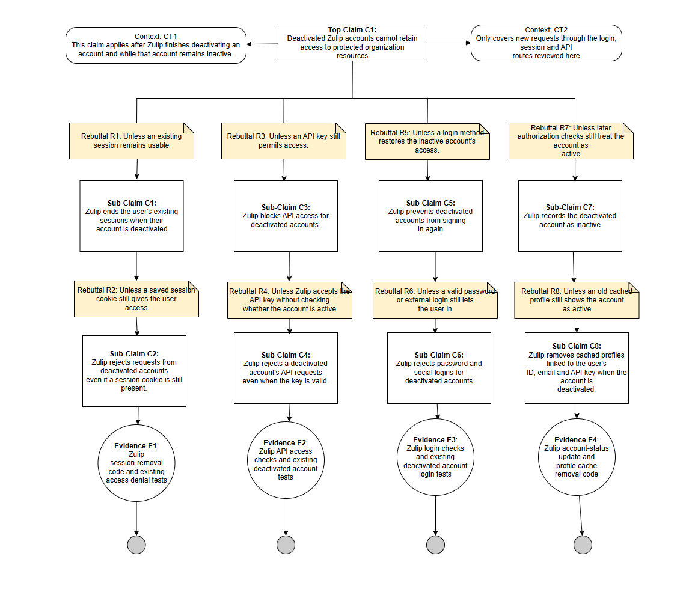

**Part 1: Assurance Cases for Software Security Engineering**

**Security Claim #1: Account Issues**
**Diagram:** 
**Claim:** Zulip protects user profile information against unauthorizes modifications.
Argument: Zulip helps user profile information by verifying authorization for profile changes, preventing unauthorized modifications. 
**Sub-Claims:**
SR21: Profile Ownership 
SR22: Unauthorized Profile Changes
SR23: Admin Profile Restrictions
SR24: Profile Update Validation
SR25: Account Chnage Auditing
**Evidence based on claims:**
SR21: Profile-update authorization checks in source code and tests
SR22: Authorization checks and tests for authorized profile changes
SR23: Document and tests for admin controlled profile-editing restrictions
SR24: Profiles-update input validation code and rejection tests
SR25: Audit-log implement and test for profile/account

Security Claim #2: Software Issues
Security Claim #3: Authentication

**Security Claim #4: Admin Manages Users' Permission and Access**

**Diagram:** 

**Claim:** Deactivated Zulip accounts cannot retain access to protected organization resources

**Ai Prompt:** You are an expert software security engineer. Your job is to improve my assurance claims for Zulip and suggest more. Ensure that all claims focus on stopping deactivated accounts from retaining access.  The claims should describe how Zulip blocks deactivated accounts from accessing protected organization resources. Each claim must include an entity, a critical security property, and the expected result. Address things like existing sessions, API keys, login attempts, and anything else that may be relevant. Identify clear rebuttals and develop supporting subclaims that resolve them. End every argument branch with existing, verified evidence from Zulip’s source code, tests, or documentation. Use noun phrases for evidence labels, provide direct source links. Do not make up or infer things that cannot be proven with verified evidence.

**Part 2**

**Alignment of Evidence and Identified Gaps**

Evidence Available: The evidence found already existed in Zulip’s repository and documentation overview. 

Evidence E1: Zulip session-removal code and existing access-denial tests:The repository includes “delete_user_sessions”, “test_clear_sessions”, and tests for requests made using retained sessions. This evidence supports claims C1 and C2 by showing the users’ session being removed and testing for access after deactivation. 

Evidence E2: Zulip API access checks and existing deactivated-account tests: 
The API authentication code checks whether the account is active. A test should show HTTP 401 when an inactive account attempts to use the API. This evidence supports sub-claims C3 and C4. The validation logic still needs to be tested to ensure the protected endpoints use it. 

Gaps: The session and API tests were inspected but not executed.

Evidence E3: Zulip login checks and existing deactivated-account login tests: Zulip implements account status checks and tests for rejected password and social logins after deactivation. This evidence supports sub claim C6 for the reviewed login methods. 

Gaps: The reviewed test does not show how every authentication configuration would behave. More active testing is required. 

Evidence E4: Zulip account-status update and profile-cache removal code:The repository contains code that saves the account as inactive and removes cached profiles associated with its ID, email, and API key. This evidence supports subclaim C7 and C8.

Gaps: The code shows that Zulips clears cached account data but we still need to test whether an old account could allow access when requests happen at the same time.

Security Claim #5: Push Notifications

**Part 2**
-Highlight gaps
-Record AI Use
-Team Reflection

