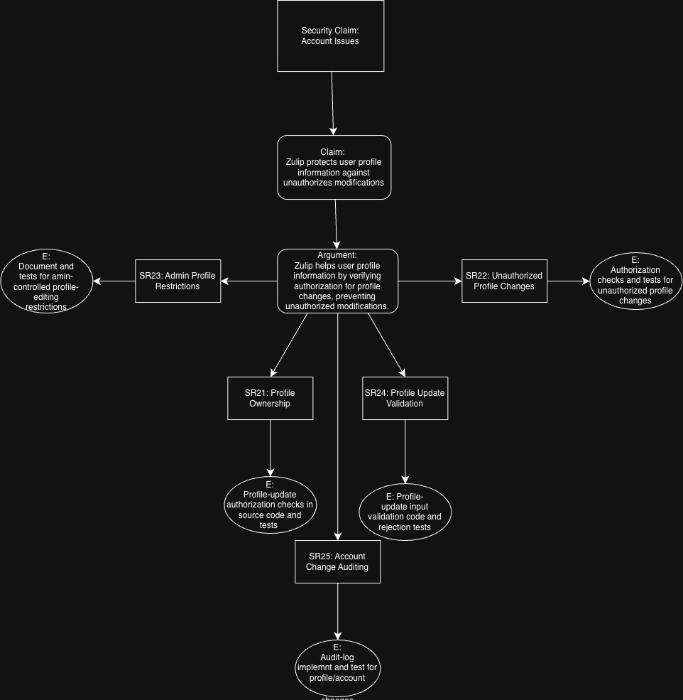

# Part 1: Assurance Cases for Software Security Engineering
## 1) Security Claim: Account Issues

image: 
**Claim:** 
* Zulip protects user profile information against unauthorizes modifications.
  
**Argument:**
* Zulip helps user profile information by verifying authorization for profile changes, preventing unauthorized modifications. 

**Sub-Claims:**
* SR21: Profile Ownership 
* SR22: Unauthorized Profile Changes
* SR23: Admin Profile Restrictions
* SR24: Profile Update Validation
* SR25: Account Chnage Auditing
  
**Evidence based on claims:**
* SR21: Profile-update authorization checks in source code and tests
* SR22: Authorization checks and tests for authorized profile changes
* SR23: Document and tests for admin controlled profile-editing restrictions
* SR24: Profiles-update input validation code and rejection tests
* SR25: Audit-log implement and test for profile/account

## 2) Security Claim: Software Issues
## 3) Security Claim: Authentication
## 4) Admin Manges Users' Permission and Access
## 5) Push Notofications

# Part 2: Access Alignment of Evidence

**Highlight gaps:**
* Making sure changes are recorded in audit logs, while audit logs are implemented with source code.
**Record AI Use:**
**Team Reflection**

