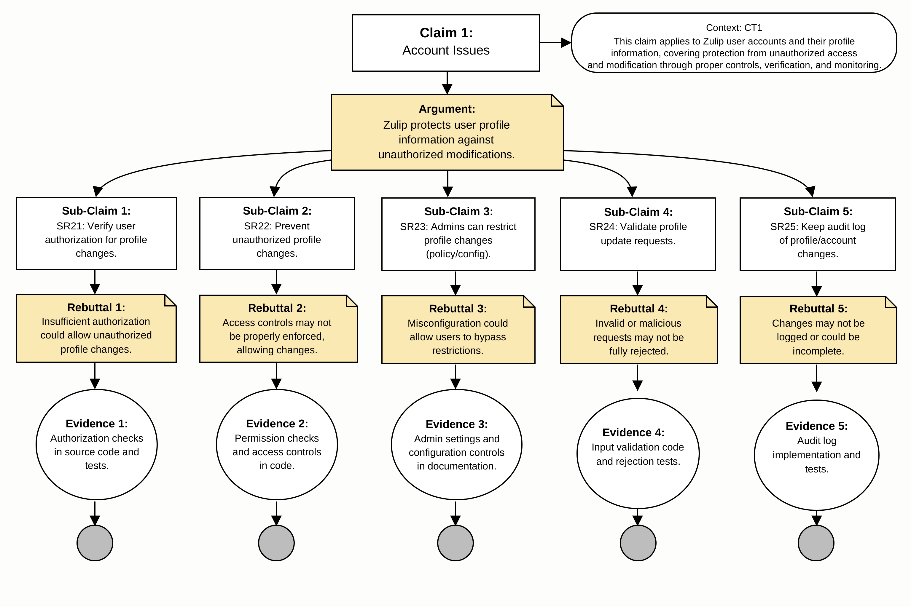
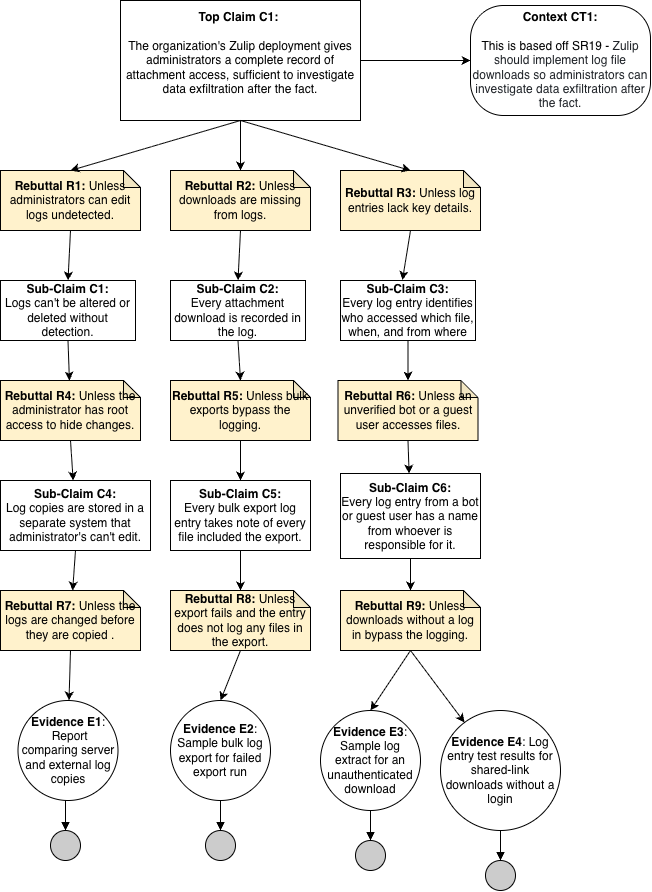
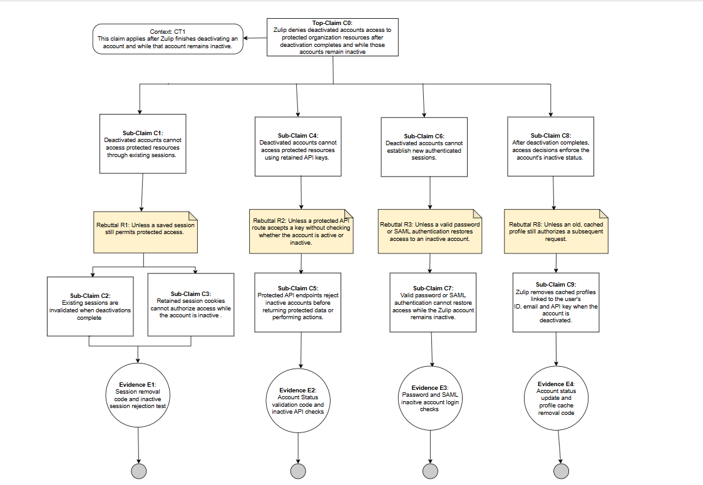
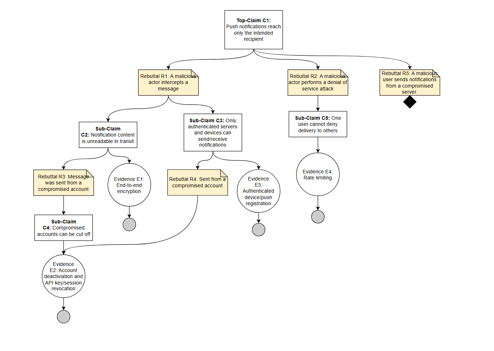

# Part 1: Assurance Cases for Software Security Engineering
## 1) Security Claim: Account Issues

image: 
**Claim:** 
* C1: Zulip protects user profile information against unauthorized modifications.
  
**Argument:**
* Zulip helps user profile information by verifying authorization for profile changes, preventing unauthorized modifications. 

**Sub-Claims:**
* C1(SR21): Profile Ownership, verifying user authorization for profile changes.  
* C2(SR22): Unauthorized Profile Changes, prevent unauthorized profile changes.
* C3(SR23): Admin Profile Restrictions, admins can restrict profile changes (policy/config).
* C4(SR24): Profile Update Validation, validate profile update requests.
* C5(SR25): Account Chnage Auditing, keep audit log of profile/account changes.
  
**Evidence based on claims:**
* E1(SR21): Authorization checks in source code and tests
* E2(SR22): Permission checks and access controls in code
* E3(SR23): Admin settings and configuration controls in documentation
* E4(SR24): Input validation code and rejection tests
* E5(SR25): Audit-log implement and test for profile/account

 **Context**
* CT1: This claims applies to Zulip user accounts and their profile information, covering protection from unauthorized access and modification through proper controls, verification, and monitoring.

**Rebuttals**
* R1: Insufficient authorization could allow unauthorized profile changes
* R2: Access controls may not be properly enforced allowing changes
* R3: Misconfiguration could allow user to bypass restrictions
* R4: Invalid or malicious requests may not be fully rejected
* R5: Changed may not be logged or could be incomplete

**AI Use**
I revised my prompt with the information from my case/information, I also included security requirements to help validity of claim from last part of project.
```
You are an expert software engineer. Please review my Zulip security claim: "Zulip protects user profile information against unauthorized modifications." Then review my argument, subclaims SR21-SR25, and supporting evidence. Identify missing evidence, possible weaknesses, and improvements to make the assurance case stronger. Focus on profile ownership, unauthorized profile changes, administrator restrictions, profile-update validation, and account-change auditing. Lastly, keeo suggestions simple and organized by claim, evidence, and rebuttal. 
Adjust where you think there needs to be further analysis or justification!

C0: Zulip protects user profile information against unauthorized modifications.
C1: Profile Ownership (SR21)
E1: Profile-update authorization checks and tests.
R1: A user may attempt to modify another user's profile.
C2: Unauthorized Profile Changes (SR22)
E2: Authorization checks and tests preventing unauthorized changes.
R2: Unauthorized profile modifications may occur.
C3: Admin Profile Restrictions (SR23)
E3: Documentation and tests for administrator-controlled restrictions.
R3: Restrictions may not be properly enforced.
C4: Profile Update Validation (SR24)
E4: Input validation code and rejection tests.
R4: Malformed requests may bypass validation.
C5: Account Change Auditing (SR25)
E5: Audit-log implementation and tests.
R5: Missing or incomplete logs may prevent investigations.
```

**AI Prompt Response**
```
C0: Zulip protects user profile information against unauthorized modifications.
C1: Profile Ownership (SR21)
- E1: Verify authorization checks ensure users can only modify their own profiles.
- R1: Authorization checks may not prevent all unauthorized profile changes.
C2: Unauthorized Profile Changes (SR22)
- E2: Test that users cannot modify other users' profiles without permission.
- R2: Authorization weaknesses may allow unauthorized modifications.
C3: Admin Profile Restrictions (SR23)
- E3: Verify administrator settings restrict profile changes as intended.
- R3: Administrative restrictions may not be consistently enforced.
C4: Profile Update Validation (SR24)
- E4: Test that malformed and unauthorized profile-update requests are rejected.
- R4: Invalid requests may bypass validation.
C5: Account Change Auditing (SR25)
- E5: Verify audit logs record significant profile and account changes.
- R5: Incomplete audit logs may make investigations difficult.
```
**AI Usefulness for Account Issues**
This prompt was useful in the sense that it identified my cases weakness from the claims and evidence standpoints. It helped me brainstorm that users can modify their own profiles and by doing so, admin restrictions are enforced for this case and missing information is rejected. The other issues when it came to audit-logs, when missing and/or incomplete can make it harder for investigate unauthorized changes appropriately. These suggestions are very minor, but helped me identify areas where the evidence and rebuttals needed to be stronger for overall better security of my account issue case. 

## 2) Security Claim: Software Issues
image: 

**Analysis/Gaps:**
Looking at the diagram versus Zulip's documentation, the strongest (still weak but fixable) branch in our assurance case tree would be the tamper branch (Logs can't be altered or deleted without detection). In [Zulip's docs](https://zulip.readthedocs.io/en/latest/production/export-and-import.html#preventing-changes-during-the-export), we found that when exporting files you can actually shutdown the instance and lock everyone out of it before exporting, "so that nobody can send new messages (etc.) while you’re exporting data." This export of data includes an archive of all uploaded files by an organization, so this concept could be be applied to logging so that data can't be tampered with when pulling it, but this is not available today and would need to be built. Our weakest branch seems to be our completeness branch (Every download is recorded in the log). I couldn't find any documentation that showed that Zulip logs included any information like that, not even for messages. Zulip's logs are strictly error logs. 

I didn’t really use a prompt with AI during this assignment in the typical way that someone would probably use one. I fed the AI the key points found in the instructions and asked it to guide me through finding the answers. It gave me a step-by-step list of things to do and as we went through them the chatbot gave me feedback and tips to improve my answers as soon as I submitted them. I would say this was extremely useful in helping me understand the assignment and the material more.


**Reflection:**
During this assignment, I learned just how much work it takes to effectively backup a claim. Our top claim fell apart when I checked it, because Zulip doesn’t have download logs, so I rewrote it to be about how the organization deploys Zulip, and the missing feature turned into a gap for Part 2 instead of a hole in the argument. I think that writing the rebuttals helped the most. I took each word in the claim and asked how it could be wrong, and that’s how I came up with things like admins editing logs without anyone noticing, bulk exports that don’t get logged, and downloads that don’t need a login.


## 3) Security Claim: Authentication

image: 

**Claim:**
* CT1: The system securely authenticates users to ensure that only legitimate users can access their accounts.

**Argument:**
* The system protects user accounts through secure authentication mechanisms, including secure password hashing, password-strength enforcement, brute-force monitoring, rate limiting, and secure password recovery. User identity can be verified through user IDs and security questions, while administrative configuration and single sign-on (SSO) policies provide additional authentication controls.

**Sub-Claims:**

* C2: User can contact an administrator or technical support for assistance.
* C3: User identity can be verified.
* C4: Technical support can be verified.
* C5: The system securely authenticates users.
* C6: The system recovers passwords safely.

**Evidence based on claims:**

* E1: User ID used as evidence to support user identification and verification.
* E2: Security questions used to help verify user identity.
* E3: Security questions used as evidence to support verification procedures.
* E4: Secure password hashing to protect stored passwords.
* E5: Password-strength enforcement to ensure users create stronger passwords.
* E6: Administrative configuration logs to support monitoring of authentication-related settings.
* E7: Single sign-on (SSO) policy settings to support secure authentication.
* E8: Brute-force monitoring logs to help detect repeated or suspicious login attempts.
* E9: Rate limiting to restrict excessive authentication attempts.
* E10: Password-reset expiration to limit the validity of password-recovery links or tokens.
* E11: Recovery controls to support secure account recovery.

**Context:**

* CT1: The user is an employee.
* CT2: An administrator is also a user of the system.

**Rebuttals and Undercutting Arguments:**

* R1: The user may be unable to access the account or log in.
* R2: The person requesting assistance may be an imposter.
* R3: The person claiming to provide support may be an imposter.
* R4: The user may forget their password.
* UC1: The authentication process may not be secure.


## 4) Security Claim: Access Prevention for Deactivated Accounts

**Diagram:** 

**Argument:** 
* The assurance case argues that Zulip denies deactivated accounts access to protected organization resources after deactivation completes and while those accounts remain inactive. Security mechanisms such as invalidating existing sessions, rejecting retained session cookies, checking account status on API requests, blocking password and SAML logins, and removing cached user profiles collectively prevent these accounts from retaining or regaining access while inactive.

**Top Level Claim:** 
* Zulip denies deactivated accounts access to protected organization resources after deactivation completes and while those accounts remain inactive. 

**Ai Prompt:** 
* You are an expert software security engineer. Your job is to improve my assurance claims for Zulip and suggest more. Ensure that all claims focus on stopping deactivated accounts from retaining access.  The claims should describe how Zulip blocks deactivated accounts from accessing protected organization resources. Each claim must include an entity, a critical security property, and the expected result. Address things like existing sessions, API keys, login attempts, and anything else that may be relevant. Identify clear rebuttals and develop supporting subclaims that resolve them. End every argument branch with existing, verified evidence from Zulip’s source code, tests, or documentation. Use noun phrases for evidence labels, provide direct source links. Do not make up or infer things that cannot be proven with verified evidence.

* Revised Prompt: End every argument branch with concrete, measurable evidence that would support my claims. Identify which evidence that already exist and which evidence still needs to be verified. Use noun phrases to label the evidence, provide direct source links to existing code, tests, or documents. 

**Reflection on AI Usefulness:**
* I have mixed opinions about using AI for this assignment. It helped me with brainstorming and putting my thoughts on paper. I often have a difficult time with coming up with the right words. It also helped with reviewing and understanding the source code.However, it made things much harder than I thought it would. I started by having it check my original work for correctness and clarity. I then wanted it to help me come up with better claims and make sure those claims were correct, could be proven and made sense in this context. I spent majority of the time second guessing myself because the AI would provide feedback on my originals thoughts and suggest something stronger but then make statements that were either wrong or based on assumptions that could not be proven. Multiple times, I had to present source code or ask a series of logical verification questions to disapprove a claim. It would eventually say, "yes you're right" after giving me reason after reason on why it was right. This caused multiple necessary and unnecessary changes to my diagram. Overall, I think AI is great for brainstorming and checking work. However, it has a bad habit of contradicting itself, which could lead you down a long and stressful rabbit hole. 

### Alignment of Evidence and Identified Gaps

**Evidence E1**: 
* Session removal code and inactive session rejection test
Zulip’s source code includes the delete_user_sessions function and the test_clear_sessions, and test_send_deactivated_user tests. The function removes the user’s sessions, while the tests check that deactivation removes those sessions and that further attempts to access the resources are rejected. This evidence supports Sub claims C1, C2, and C3 by addressing session removal and rejection of access through retained sessions. 

* Gaps: The source code and tests were reviewed, but the test were not officially executed.  The tests need to be executed to confirm that sessions are removed and retained sessions are rejected. Source: [delete_user_sessions](https://github.com/zulip/zulip/blob/ef6e64bd3cb4e2fe7ed993e68e3b05ff576ee816/zerver/lib/sessions.py#L50-L53), [test_clear_sessions](https://github.com/zulip/zulip/blob/ef6e64bd3cb4e2fe7ed993e68e3b05ff576ee816/zerver/tests/test_users.py#L2392-L2409), and [test_send_deactivated_user](https://github.com/zulip/zulip/blob/ef6e64bd3cb4e2fe7ed993e68e3b05ff576ee816/zerver/tests/test_decorators.py#L750-L794)

**Evidence E2**: 
* Account status validation code and inactive API checks
Zulip’s source code includes the validate_account_and_subdomain function and the test_send_deactivated_user test. The function rejects inactive accounts.  The test checks if a deactivated account can send a message using its API key. This evidence supports C4 and C5 through the shared inactive account check a test that expects HTTP 401 when an inactive account attempts to send a message using its API credentials.  

* Gaps: The reviewed code supports inactive account rejection through shared API authentication. However, this was not tested in this review.
 Source: [validate_account_and_subdomain](https://github.com/zulip/zulip/blob/ef6e64bd3cb4e2fe7ed993e68e3b05ff576ee816/zerver/decorator.py#L280-L310), [test_send_deactivated_user](https://github.com/zulip/zulip/blob/ef6e64bd3cb4e2fe7ed993e68e3b05ff576ee816/zerver/tests/test_decorators.py#L750-L794), and [Shared Authentication Code](https://github.com/zulip/zulip/blob/ef6e64bd3cb4e2fe7ed993e68e3b05ff576ee816/zerver/decorator.py#L784-L833)

**Evidence E3**: 
* Password and SAML inactive account login checks 
Zulip’s source code includes test_login_deactivated_user and test_external_auth_id_saml_deactivated_user. These tests check to see if password and SAML login attempts are rejected after account deactivation.  They support C6 and C7 by checking that a login request from a deactivated account does not restore access.

* Gaps: The existing code was reviewed, but it was not tested. The authentication setup needs to be verified through testing in the environment. 
Source: [test_login_deactivated_user](https://github.com/zulip/zulip/blob/ef6e64bd3cb4e2fe7ed993e68e3b05ff576ee816/zerver/tests/test_decorators.py#L813-L824), [test_external_auth_id_saml_deactivated_user](https://github.com/zulip/zulip/blob/ef6e64bd3cb4e2fe7ed993e68e3b05ff576ee816/zerver/tests/test_auth_backends.py#L4526-L4580)

**Evidence E4**: 
* Account status update and profile cache removal code
Zulip’s source code includes change_user_is_active, flush_user_profile, and delete_user_profile_caches. These functions save the account’s inactive status and clear the affected cache profiles. These functions support C9 and partially support C8 by showing how account deactivation triggers the removal of affected cached information.

* Gaps: The code shows that affected cached profiles are cleared.  However, verification is needed on whether request started after deactivation consistently use the correct account status when other request overlap deactivation. 
Source: [change_user_is_active](https://github.com/zulip/zulip/blob/ef6e64bd3cb4e2fe7ed993e68e3b05ff576ee816/zerver/actions/users.py#L240-L253), [flush_user_profile](https://github.com/zulip/zulip/blob/ef6e64bd3cb4e2fe7ed993e68e3b05ff576ee816/zerver/lib/cache.py#L689-L698), and  [delete_user_profile_caches](https://github.com/zulip/zulip/blob/ef6e64bd3cb4e2fe7ed993e68e3b05ff576ee816/zerver/lib/cache.py#L612-L628).

**Reflection**:
* The assurance case I worked one was interesting. I thought it would be easy to think through, but it turned out be more challenging than I expected. Despite those challenges, the deep dive into Zulip's documentation was very informative. I learned a lot about how it handles account deactivation and the security checks needed to prevent. It is a complicated process because someone could attempt to access the system through retained sessions, saved API keys, or valid login credentials. Zulip has to coordinate several security checks to block these access methods while the account remains inactive. Its source code and documentation was extremely useful because I could follow the relevant functions and understand how connected to the claims I was trying to prove.
  
## 5) Push Notofications


### AI Use  
I took pieces of the example prompts in the assignment and modified them with information from the slides. Included in the prompt were my original claims, rebuttals, evidence and one undermine. I was struggling coming up with more evidence and rebuttals and Claude helped flesh out the ones I had and suggested ones I missed.

```
You are an expert software security engineer. Your job is to inspect and suggest edits to a list of claims, evidence, rebuttals
and undermines, etc. in an assurance case review. A claim is always worded with a predicate. Avoid claims about the supporting
method/techniques. Claims should be a reasonable goal. Good arguments eliminate identified doubts or rebuttals. Claims are
used to eliminate the doubts. Example of a good claim: "The system minimizes information disclosure during communication"
Doubts can attack claims, evidence, or inferences. Here is an example claim with evidence, rebuttals, and an undermine.
Analyze based on mobile push notifications, and the threat actors to focus on are malicious users and compromised servers.

Claim: Zulip ensures that users receive notifications meant for them
Rebuttal 1: A malicious actor intercepts a message
Claim 1.1: Zulip ensures there is end to end encryption
Claim 1.2: Zulip uses notification certification and authentication
Rebuttal 1.1.1/1.2.1: Unless the message was sent from a compromised account
Rebuttal 2: A malicious user wants to perform a denial of service attack
Evidence 2: Zulip uses rate limiting

Use this as a potential claim for analysis, ask any clarifying questions
```  
The following list is part of what Claude generated in response:
```
C0: Zulip ensures users receive notifications meant for them

R1: A malicious actor intercepts a message
  C1.1: Notification content is unreadable in transit
    E1.1: End-to-end encryption of push payloads
    R1.1.1: Sent from a compromised account
      C1.1.1: Compromised accounts can be cut off
        E1.1.1: Account deactivation and API key/session revocation
  C1.2: Only authenticated servers and devices can send/receive notifications
    E1.2: Push bouncer registration with server authentication and
          user-bound device tokens
    R1.2.1: Sent from a compromised account
      C1.2.1: Compromised accounts can be cut off
        E1.2.1: Same as E1.1.1

R2: A malicious user performs a denial of service
  C2: One user cannot deny delivery to others
    E2: Rate limiting
```
### Notification alignment  
* End-to-end encryption is highlighted in the [security and privacy](https://zulip.readthedocs.io/en/stable/production/mobile-push-notifications.html#security-and-privacy) section and ensures that the content and metadata are not visible to Apple, Google, or Zulip's Mobile Push Notification Service. This covers the readability of notifications from an outside source or someone listening or intercepting notifications.
* Zulip does support account deletion/deactivation via their [Other useful manage.py commands](https://zulip.readthedocs.io/en/stable/production/management-commands.html#other-useful-manage-py-commands). This covers ordinary malicious users and malicious users with stolen credentials of a legitmate account.
* I had to do a little research on Claude's recommendation of the push bouncer registration. This is just the middle man between Zulip and Apple or Google's Push Notification Service. Zulip's documentation does talk about the [cryptography](https://zulip.readthedocs.io/en/stable/production/mobile-push-notifications.html#cryptography) used in devices' registration with the actual Push Notification Server to ensure that the token given to a device does not get learned by the Zulip server while it is in transit to the bouncer.
* [Rate limiting](https://zulip.readthedocs.io/en/stable/production/mobile-push-notifications.html#rate-limits) is talked about shortly after the cryptography piece and says that the default rate limit is 1000 requests per minute but can be configured through support if a server is big enough to warrant a higher rate limit. This prevents Denial of Service attacks.

### Gaps
* Compromised servers could still cause issues due to sending malicious notifications and messages from a legitimate looking server.

### Reflection
Throughout this sprint/segment of the assignment I learned how to draw an assurance case diagram and over time fine tune it to be concise yet still show where there is evidence and where claims can fall short. I also leaned into the prompt engineering on this assignment to further strengthen my claims, rebuttals, and evidence to cover areas that I missed to begin with. I found the template that was provided for the assurance case very useful. To see an example laid out and how each branch from the claim led to more and more evidence helped me visualize my own assurance case diagram as I worked through piecing it together.

# Part 2: Access Alignment of Evidence
  
**Team Reflection**

