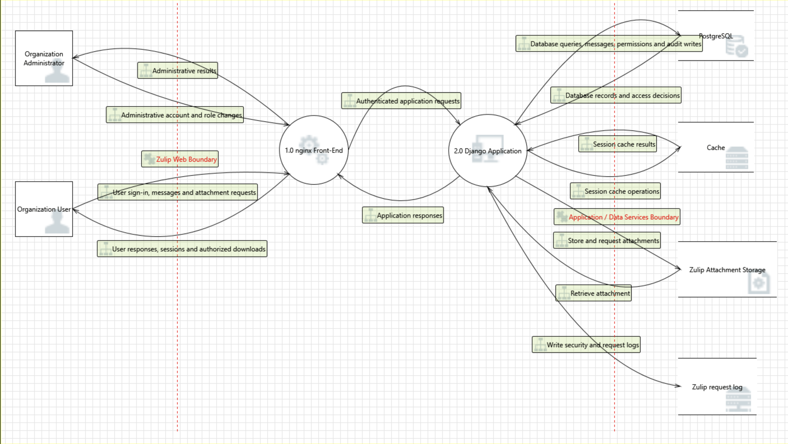
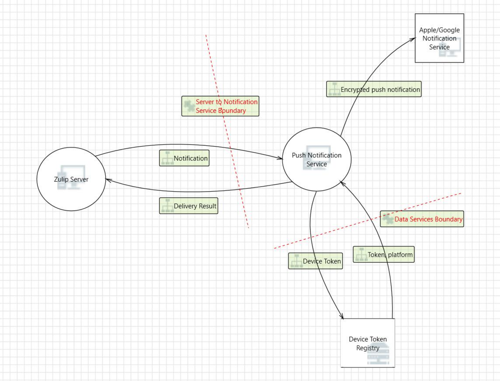

# Part 1: Threat Modeling
**1.1: Project Overview**

This security engineering view focuses on threat modeling through Zulip's user accounts and profile management features. The focus is to prioritize past assurance cases/security requirements to protect information from unauthorized modifications. 

The course of action to support these scenarios are broken down into structured parts. First we are creating DFDs for our previous claims and combining them into several diagrams that have related claims. Second we are then analyzing those DFDs in more depth by looking at their STRIDE analysis; Spoofing, Tampering, Repudiation, Information Disclosure, Denial of Service, Elevation of Privilege. Mainly looking at the per interaction basis, that shows the source and target element connected by a data flow. Third then we can gather up potential threats based on the complexity of our DFDs. Then lastly, we will address threat mitigation and how we can; redesign to eliminate any threats mentioned from previous section, how to apply standard mitigations, how to invent new mitigations even if they seem to be risky, and what are you willing to accept in terms of vulnerability based from designing aspect. 

Then for observations, we will simply look at Zulip's existing protections and any recommendations based on those security gaps. Then lastly we will collaborate on how we went about project and what we concluded from process and what results tell us about our design capabilities. 

**1.2: Data Flow Diagrams (DFDs)**  

Zulip Sign-in, Messaging and Attachments

For our notifications DFD, we came up with this diagram:  
  
**1.3: STRIDE Threat Analysis**

**Messaging and Attachments (Zulip sign in --> Messaging/Attachments)**

Spoofing
* The attack could gain stolen credentials, to then act as they are the user that should have legitamite access.
  
Tampering 
* The attack could modify anything that could be in transit when you look at certain requests from messaging.

Redupdiation
* Denial of submitting or receiving a message as the user.

Information Disclosure
* Anything sensitive could be exposed in terms of message date or leaked credentials.

Denial of Service
* Having excessive message requests could overwhelm the front-end of business operations.

Elevation of Privilige
* The attacker can try and gain access then get into accounts that can expose other functions.

**Notification (Zulip Server --> Push Notification Service)**

Spoofing
* The attacker acts as the Zulip server and then can send any notification that even may be unauthorized.

Tampering
* The notification settings can be modified in transit that can impact notification service itself.

Repudiation
* The server cannot decipher if a notifcation was intially sent is logging is not considered in process.

Information Disclosure
* Anything confidential can be exposed like other diagram via notification context.

Denial of Service
* The large amounts of requests can cause issues or internal problems to push notification service.

Elevation of Privilege
* The attacker can abuse the notification system through requests that can trickle to expose unauthorized user and accounts they are trying to acquire.

**1.5: Mitigation Strategies**  

**Messaging and Attachments (Zulip sign in --> Messaging/Attachments)**

* Redesign to eliminate: Restrict direct access to message and attachment storage by requiring all requests to pass through the Zulip server. This prevents users from bypassing authorization checks to access private messages or attachments.
  
* Mitigation Standards: Implement rate limiting to prevent excessive messaging requests and Denial-of-Service attacks,use authentication and authorization protocols to verify user identities and ensure only legitimate users can access messages and attachments, encrypt messages and attachments during transmission using HTTPS/TLS and protect stored information through encryption at rest, maintain audit logs with timestamps and user activity records to help investigate unauthorized modifications or disputed messaging activities.

* Invent new mitigations: Adding step-up verification (such as a multi-factor authentication (MFA) or re-authentication) when accessing sensitive data or high-risk actions could lower credential-stuffing or phishing success, though it adds friction for legitimate users and requires careful tuning to avoid false positives. 
  
* Accept vulnerability: Messaging disruptions may occur because of network outages, server maintenance, or unexpected service interruptions.Additionally, audit logs cannot completely prevent users from denying their actions, but retain sufficient records to investigate disputes and suspicious activity.

**Zulip Server --> Push Notification Service**

* Redesign to eliminate: Trying to not include sensitive contents when looking at push notifications, the more generic the better.
* Mitigation Standards: Use Zulips previous controls and add; encryption, input validation, access controls, rate limits.
* Invent new mitigations: This is risky, but if you invest more in abnormal activity that provide alerts the volume of notification requests could be monitored better.
* Accept vulnerability: Relying on external push providers that can dictate if risks are low and approved for delivery disruptions.
  
***1.5a: AI Statement***  
On this assignment, there were a handful of mitigations that I got blocked on so I turned to Claude and asked for help searching the documentation for Zulip on the issues I couldn’t find answers to. Having the ability to quickly scan for specific use cases and mitigations 
was invaluable in this case as it would have taken way too long to scour some for some of the pages that had the answers I was looking for. I had Claude give me a justification for a specific threat and then also provide links to where I could find the answer it provided me. I verified the
information it was giving me was accurate and covering the point I was looking for before adding it to my TMT report.

* Michael:
  - Prompt: I asked AI to check if my Zulip diagram followed the DFD examples in the class slides. Then I ask whether the process, data stores, and trust boundaries made sense for my scenario.  I kept asking for examples from Zulip’s code that could ensure that my data flow and interactions were correct. I made sure to manually check the code because the AI made assumption that made no sense or didn’t fit in this context.I then ask AI to help me review and brainstorm mitigations for my threat report. I was helpful, but it made stressful at times. For example, based on what I knew about how Zulip works, I thought a threat should be marked “Mitigation Implemented,” but the AI marked it “Needs Investigation.” I disagreed and we found code showing what Zulip’s audit log recorded and how that addressed the threat. This kind of back and forth happened allot. Despite the struggle in coming to a consensus, AI helped me analyze the code, expanding flesh out my mitigation statements, and check that each one made sense for the threat I was describing. 

 
**1.6: HTML Reports (link)**
 - [Threat Modeling Report for Zulip Sign-in, Messaging and Attachments](https://htmlpreview.github.io/?https://github.com/loedetyler/SA_Project/blob/main/images/ZulipSign-in.htm)
 - [Threat Modeling Report for Zulip Notifications](https://htmlpreview.github.io/?https://github.com/loedetyler/SA_Project/blob/main/reports/Notification_report_2.htm)   

# Part 2: Observations

**2.1: Existing Protections for Zulip**

Zulip has a few existing potential security mechanisms designed to protect user accounts and profile information in respect to what we have created based on our project.

Authorization

* Zulip also offers permission checks that can control which users perform certain tasks within environment. These checks make sure that when a user changes information they have authroization and are authorized to modify. This part showed code of how that implemented within system and how each each key feature mentioned comes from authorization and each department e.g. Endpoint all can play a part in this process.

Source: https://github.com/zulip/zulip/blob/main/zerver/views/user_settings.py

Profile validation

* Zulip shows process update requests through the view of server-side application. This helps validate and ensure that the submitted information follows the applications set in place security requirements and inherently prevents invalid and unauthorized changes when flagged in system. This is also represented as code to do so, while providing different type of errors and how that is validated in system. 

Source: https://github.com/zulip/zulip/blob/main/zerver/views/user_settings.py

Authentication

* Zulip does support a wide variety of authentication methods; email and password, social   authentication, Microsoft Entra ID, LDAP (including Active Directory), SAML, OpenID Connect,  JSON Web Tokens (JWT), Apache-based SSO with REMOTE_USER. All these methods verify a user's identity before fully granting them access to an account. Authentication is one of the most important features as its prevents unwanted access for users to access other user's accounts and modify any profile information in that process. 

Source: https://github.com/zulip/zulip/blob/main/docs/production/authentication-methods.md
   
Audit Logging

* This is least emphasized but key importance in existing system and our teams project. The functionality records show how administration supports account related actions. These records in the files investigate changes and identify potenially unauthorized activity to show up. This is also code on how to do go about doing that within system. Interestingly here made are just extracting data from current models from authentication methods and using data to see for analytical purposes.

Source: https://github.com/zulip/zulip/blob/main/zerver/models/realm_audit_logs.py?utm_source=chatgpt.com

**2.2: Security Gaps & Recommendations**  
After doing the TMT exercise, for the notification case, there were a lot of Denial of Service threats on top of Escalation of Privilege threats that the app found. As far as gaps, most of them were covered in the documentation. There were a few that we put as needs investigation just because it relied on configurations set up on the host/server but for default there wasn't much of a gap around the Notification service.

Identified in our previous research, one significant gap was the lack of attachment download logging. With detailed download records, administrators could have issues seeing which users accessed files, when downloads occurred, or whether confidential information was leaked. Even though Zulip has controls that help prevent unauthorized access, they can not completely prevent malicious insiders from misusing information they are authorized to access. We believe that improving their auditing and investigative capabilities would help organizations identify potential data exfiltration.

**2.4: Team Reflection**

**- Michael:** This assignment was challenging but not in a bad way. It reminds of what I do at work. Most of my days are spent validating security control and assessing whether an application or system is properly secured.  I have learned a lot about why each step of developing a threat model is Important and why security should be in every aspect of developing a system. I thought the hardest part of this assignment would be drawing the diagram. However, answering the mitigations were challenging for me. It required a lot of analyzing and fact finding. It’s difficult trying to figure out all the possible attack vectors a system may be vulnerable too. Developing a threat model is one way we can bridge the gaps in security in before attackers get the chance to exploit them.

**- Tamir:** Creating the DFD for Zulip showed me how messages and attachments move between users, the application server, and storage. Trust boundaries are important, especially when sensitive information enters or leaves the server. I used the STRIDE analysis and that help me realize that simple operations, like sending messages or downloading files, can potentially introduce security risks. The most helpful part was being able to connect what we did in previous assignments to the DFDs and see where security still needs to be improved.  

**- Tyler: I agree with Michael, this assignment was challenging. Doesn't quite remind me of what I do at work but it was fun getting to play around with a new tool that I had no clue existed. Having the ability to draw up a diagram showing boundaries, processes, datastores,  interactors, and the flows between them and then hitting a button to generate some of the threats that could be found in projects designed in the way we lay it out. Obviously if there are errors in the layout, that will reflect in the threats found whether that's showing a threat that wouldn't be found in a particular data flow or if we don't catch a threat that would be found, it is important to fully understand how to design these diagrams. It also helps further our understanding of just what exactly we are analyzing with this project. Doing this exercise furthers our knowledge of just what goes on "under the hood" in a Zulip server.  

**-Kauser:** I focused on reviewing the models and reports. Even from that vantage point, tracing Zulip's data flows, trust boundaries, and STRIDE findings helped me understand why identifying potential attack vectors and security gaps early matters so much. Reviewing the team's analysis also made it clearer how the earlier diagrams connect to threat modeling and where security improvements are still needed before issues can be exploited.

**-Payten:** I started the project by providing an outline and explaining more specifically what we were trying to accomplish in project overview. I also did the STRIDE work that helped just explain how each show up in terms of threat modeling. I also examine in terms of per interaction mitigation strategies even though you could provide excess amount to show what could be done. I also showed Zulips existing protections to show what improvements or additions are needed to be made for better security.
